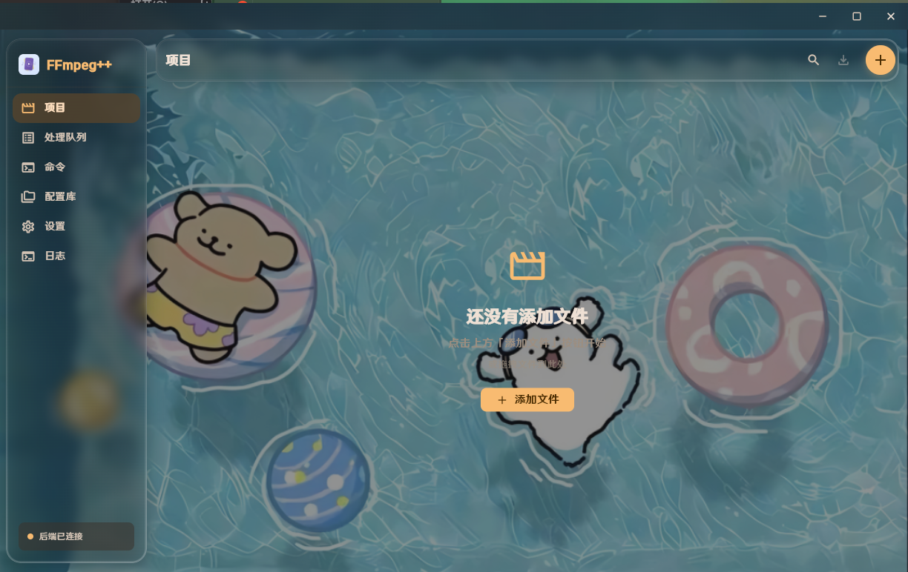
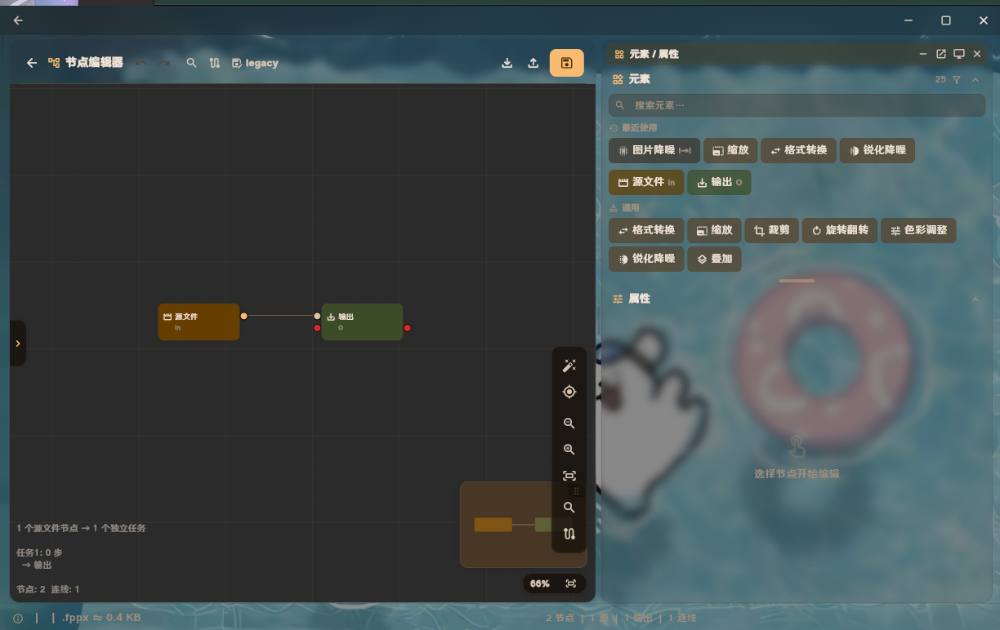
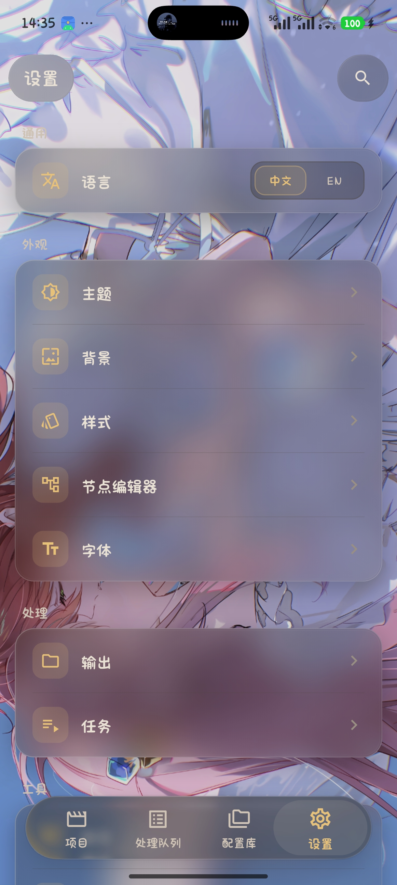

# 🎬 FFmpeg++

<div align="center">

**蓝图式节点化音视频处理桌面应用 —— 把复杂的 FFmpeg 变成看得见的工作流**

[](https://flutter.dev)
[](https://flutter.dev)
[](https://isocpp.org)
[](https://ffmpeg.org)
[](LICENSE)

[English](README_EN.md) | 简体中文

</div>

## 这是什么

用 `ffmpeg -i ... -vf ...` 处理一个视频，大致是：查文档、拼参数、跑一遍、发现顺序反了、再查一遍。

**FFmpeg++** 想换一种方式。在无限画布上摆好「开始 → 处理 → 输出」几个节点，用线连起来，应用会校验整张图，
并把它翻译成真正执行的 `ffmpeg` 调用。转码、滤镜、字幕、音频、批量处理——流程终于能被「看见」，
能被保存、复用、发给别人。

界面是 **Flutter** + Material Design 3，处理内核是一个 **C++17** 共享库，通过 Dart FFI 调用，
真正干活儿的仍然是 **FFmpeg / ffprobe**。换句话说：能力一点没少，只是不用再背手册了。

> 💡 **关于代码**——这个项目绝大部分代码是在 AI 协作下写出来的，方向、取舍与验收由人把关。
> 我们把它写进这里，不是为了讲故事，而是想说明：在今天的工具条件下，一个人也可以撑起这样一个规模的跨平台应用。

## 它想解决的问题

| 痛点 | FFmpeg++ 的做法 |
|------|----------------|
| **命令太长** —— 滤镜、编码器、映射、字幕烧录，随随便便几十个开关 | 可视化节点 + 参数面板，非法组合当场标出来 |
| **重复劳动** —— 同一套流程要套用到几百个文件 | 一张图批量套用到多个源文件，统一进入处理队列 |
| **过程不直观** —— 一条长命令看不出先后 | 画布上就是执行顺序，还能看到生成的命令 |

## 三种用法

选哪种都行，它们共用同一个后端，随时可以互相切换：

| 方式 | 适合的场合 |
|------|-----------|
| 🧩 **节点编辑器** | 多步骤、多分支的复杂流程：转码 + 滤镜 + 字幕 + 音频处理串成一张图 |
| 🎚 **快捷配置** | 单个文件快速处理：预设面板里选好参数，直接入队 |
| 🧠 **命令模式** | 需要完全自由：手写 ffmpeg 命令，带模板与参数参考 |

## 截图

<p align="center">
  
  
</p>

**主界面**是整个应用的入口。左侧导航在「项目 / 处理队列 / 命令 / 配置库 / 设置 / 日志」之间切换；
媒体以卡片陈列，支持拖放导入、缩略图预览与 ffprobe 自动探测（编码、分辨率、时长、码率）。
选中文件即可进入节点编辑器，或直接套用快捷配置；处理任务统一进入队列。

**节点编辑器**是核心工作区。顶部工具栏负责保存、撤销、重做、自动排版与调试视图；中间是无限画布，
节点用端口连线，右键即可增删；右侧跟随选中节点展开参数面板。执行之前，整张图会被完整校验一遍。

## 节点编辑器怎么用

只需三步。

### 第一步：摆放节点

从工具栏或右键菜单把处理节点放到画布上。每条流程以 **开始节点** 起步、以 **输出节点** 收尾，中间按需插入处理节点：

- **转码与滤镜**：视频转码（编码器 / 码率 / CRF / 分辨率 / 帧率）、视频滤镜（亮度、对比度、饱和度、伽马、色相、暗角、降噪、锐化、黑白）、
  画面变换（缩放 / 翻转 / 旋转）、画面叠加（水印 / Logo，五档定位 + 透明度 + 缩放 + 边距）
- **音频**：转码、变速、音量、动态压缩、淡入淡出、元信息、提取音频
- **图像**：格式转换、裁剪、旋转、缩放、亮度、调整（饱和度 · 伽马 · 对比度）、噪点、锐化、降噪、通道提取
- **节奏与裁切**：变速、时间范围截取、单帧 / 范围分帧 / 全部分帧、交互式画面裁剪
- **组合**：多文件拼接、图片序列合成视频、字幕烧录（SRT / ASS / SSA，带拾色器与字体选择器）

### 第二步：连线成图

拖动端口，把「上一步的输出」接到「下一步的输入」。编辑器会持续校验这张图：

- 环路检测、连线类型冲突、悬空节点、缺少开始 / 输出节点
- 时长约束 —— 例如截取时长与后续节点对不上时会提示
- 多个可合并的节点会被自动坍缩成 **一条 ffmpeg 命令**，而不是反复重编码

**逻辑块与逻辑门**让流程图不只是一条直线：循环块能按次数或条件反复执行一段子链；
与 / 或 / 非 / 与非 / 或非 / 异或 / 同或门、恒 1 / 恒 0、时间触发器可以作为「使能端 / 状态端」，
控制某些处理节点是否生效——相当于给处理流程装上了条件分支。

### 第三步：执行与复用

一个 **源文件节点** 对应一个独立任务，所以同一张图可以批量套用到多个文件上；任务会在处理队列中依次执行，
进度、速度、剩余时间实时回显。

图搭好之后，可以存进 **配置库**、导出为 `.fppx` 工程文件分发给别人。再次导入时，会自动校验配置与你的软件版本、
媒体类型是否匹配，避免「拿到别人的流程却跑不起来」。

## 还内置了什么

### 🤖 AI 助手

内置 AI 对话面板，可以直接用自然语言描述需求（例如「把这个视频压到更小的体积，顺便加水印」），
由 AI 生成或修改画布上的节点与参数，不用手动摆放。

支持 **OpenAI 协议** 与 **Anthropic 协议** 两类接口，可配置多个模型档案与多 API Key 轮换，密钥在本地加密存储。

### 🔌 MCP 服务（Model Context Protocol）

FFmpeg++ 内置一个 MCP HTTP 服务器（**默认关闭**），把整个应用接入 AI 客户端与自动化工作流：

- **端点**：`http://127.0.0.1:<端口>/`，JSON-RPC 2.0 over HTTP POST，支持批量请求与协议版本协商
- **工具（30+）**：画布操作（`add_node` / `connect_nodes` / `modify_node` / `undo` / `save` / `rename_node` …）、
  读取（`list_nodes` / `list_connections` / `get_graph_stats` / `error_check`）、媒体与文件（`probe_video` / `list_directory` / `read_file_info`）、
  任务（`list_tasks` / `get_task_info` / `cancel_tasks`）、逻辑门（`add_gate` / `set_gate_params`）、容器（`list_containers` / `get_container_pipeline`）等
- **资源（3 个）**：`pipeline://current`、`videos://loaded`、`tasks://all`
- **权限开关**：允许写入（默认关，关闭时修改类工具一律被拒绝）；允许文件系统访问（默认开，控制目录枚举 / 文件信息 / 媒体探测 / 日志读取）
- **安全**：默认只监听 `127.0.0.1`；改为 `0.0.0.0` 暴露到局域网时，强制校验访问令牌（请求头 `x-mcp-token` 或 `Authorization: Bearer <token>`，令牌在设置页展示）

> 主流桌面 MCP 客户端使用 stdio 传输，如需接入请通过 `mcp-proxy` 一类的 HTTP ↔ stdio 桥接工具转发。

### 📱 Android 移动端

同一套代码也构建了 Android 版本（arm64-v8a，Android 8.0+），针对触屏重新排布了布局：

<p align="center">
  
  &nbsp;&nbsp;
  
</p>

<p align="center"><sub>左：项目页 · 右：设置页（语言切换与外观选项）</sub></p>

- 侧边栏换成底部液态玻璃导航栏，四个入口：项目 / 处理队列 / 配置库 / 设置；胶囊遮罩可拖动选择
- 设置页按 **通用 · 外观 · 处理 · 工具** 分组，语言（中文 / EN）、主题、背景、样式、节点编辑器、字体、输出与任务一目了然
- Android 8.1+ 支持 Monet 动态取色，跟随系统壁纸生成 Material You 配色
- **内置 ffmpeg / ffprobe** 静态可执行文件随 APK 打包，无需任何外部依赖
- GPU 硬编码器不可用时会自动回退到 CPU 编码

### 🛠 其它细节

- **界面**：深色 / 浅色主题、主题色、背景图片、多种表面样式（液态玻璃 / 模糊 / 纯色）、字体与字号、快捷键自定义、中英文界面
- **FFmpeg 安装助手**：内置引导——Windows 走 winget，Linux 走 apt / dnf / pacman，macOS 走 Homebrew，也支持从压缩包导入
- **编辑体验**：画布自动排版、撤销 / 重做、自动保存、调试覆盖层显示执行计划
- **处理队列**：顺序批量执行、结果持久化、单任务取消与「停止所有」
- **应用更新**：内置更新检查与下载安装（校验 SHA-256）

## 下载与安装

| 平台 | 架构 | 安装包 |
|------|------|--------|
| **Windows** | x64 | `FFmpeg++_v*_setup.exe` |
| **Linux** | x64 | `ffmpegpp_*_amd64.deb` |
| **Linux** | ARM64 | `ffmpegpp_*_arm64.deb` |
| **macOS** | Universal（Intel + Apple Silicon） | `FFmpeg++_v*_macOS.dmg` |
| **Android** | arm64-v8a | `app-release.apk` |

**➡️ [前往 GitHub Releases 下载全部平台安装包](https://github.com/lvbaoshigao/FFmpeg_plus_plus/releases)**

在 Release 页面的 **Assets** 区域选择上表中对应的文件即可。Windows 安装包内置简繁中文与英文安装向导；
`.deb` 可用 `sudo dpkg -i` 或 `sudo apt install ./*.deb` 安装。

> **关于 FFmpeg 依赖**：桌面端首次启动若未检测到 `ffmpeg` / `ffprobe`，应用会引导你一键安装
> （winget / apt / dnf / pacman / Homebrew）或从已有压缩包导入；Android 版已内置，开箱即用。

## 从源码构建

<details>
<summary>展开环境要求、构建步骤与技术栈</summary>

### 架构

```
┌──────────────────────────────────┐
│   Flutter GUI (Dart)             │  ← Material Design 3
│   Dart FFI ↔ libffmpegpp         │
├──────────────────────────────────┤
│   C++17 后端 (dll / so / dylib)  │  ← 共享库，消息队列轮询
│   subprocess → ffmpeg / ffprobe  │
├──────────────────────────────────┤
│   FFmpeg / FFprobe               │  ← 外部进程
└──────────────────────────────────┘
```

### 环境要求

- [Flutter SDK](https://flutter.dev) 3.44+
- [CMake](https://cmake.org) 3.20+
- **Windows**：Visual Studio 2022/2025（C++ 桌面开发负载）、[Inno Setup](https://jrsoftware.org/isinfo.php) 6+
- **Linux**：`cmake g++ libgtk-3-dev pkg-config ninja-build`
- **macOS**：Xcode Command Line Tools
- **Android**：Android SDK + NDK 28.2 + JDK 17+

### 手动构建

```bash
# 1. 编译 C++ 后端
cd server_cpp
mkdir -p build && cd build
cmake .. -DCMAKE_BUILD_TYPE=Release
make -j$(nproc)                 # Linux / macOS
# Windows: cmake .. -G "NMake Makefiles" && nmake

# 2. 运行 Flutter GUI
cd ../../ffmpegpp_gui
flutter pub get
flutter run -d linux            # 或 -d windows / -d macos
```

### 一键构建脚本

构建脚本集中在 `build/` 目录，详见 [`build/README.md`](build/README.md)：

```bash
build/build_all.sh all          # 桌面端 + Android APK
build/build_all.sh desktop      # 仅桌面端
build/build_all.sh android      # 仅 Android APK
```

### 目录结构

```
FFmpeg_plus_plus/
├── ffmpegpp_gui/     # Flutter 前端（UI、状态管理、节点编辑器、MCP 服务）
├── server_cpp/       # C++17 后端（命令生成、进程调度、.fppx 编解码、音视频探测）
├── build/            # 统一构建脚本（桌面端 / Android）
├── make/             # 安装器脚本、图标与截图资源
└── .github/          # GitHub Actions 发布流水线
```

### 构建产物

| 平台 | 路径 |
|------|------|
| Windows | `ffmpegpp_gui/build/windows/x64/runner/Release/` |
| Linux | `ffmpegpp_gui/build/linux/x64/release/bundle/` |
| Android | `ffmpegpp_gui/build/app/outputs/flutter-apk/app-release.apk` |

### 技术栈

| 层级 | 技术 |
|------|------|
| UI 框架 | Flutter 3.44 · Material Design 3 |
| 状态管理 | Provider（ChangeNotifier） |
| 后端 | C++17 共享库（dll / so / dylib），Dart FFI 加载 |
| 处理引擎 | FFmpeg 8.0 / ffprobe（子进程） |
| 音频预览 | just_audio（Linux 上为 GStreamer） |
| 安装包 | Inno Setup（Windows）· dpkg-deb（Linux）· hdiutil（macOS） |
| CI/CD | GitHub Actions —— Windows / Linux x64 / Linux ARM64 / macOS / Android |

</details>

## 星标历史

<a href="https://star-history.com/#lvbaoshigao/FFmpeg_plus_plus&Date">
  <picture>
    <source media="(prefers-color-scheme: dark)" srcset="https://api.star-history.com/svg?repos=lvbaoshigao/FFmpeg_plus_plus&type=Date&theme=dark" />
    <source media="(prefers-color-scheme: light)" srcset="https://api.star-history.com/svg?repos=lvbaoshigao/FFmpeg_plus_plus&type=Date" />
    
  </picture>
</a>

---

<div align="center">

<sub>Flutter · C++17 · FFmpeg —— 代码主要由 AI 协作完成，设计、取舍与验收由人负责</sub>

MIT License — 详见 [LICENSE](LICENSE)

</div>
