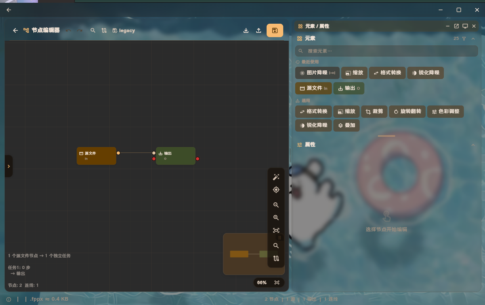
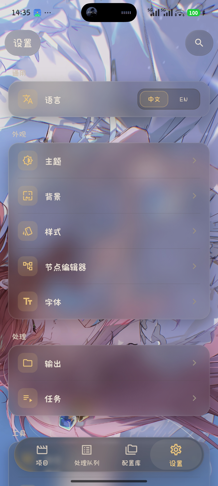

# FFmpeg++

<div align="center">

**基于节点工作流的跨平台音视频与图像处理应用**

[](https://flutter.dev)
[](https://flutter.dev)
[](https://isocpp.org)
[](https://ffmpeg.org)
[](LICENSE)

[English](README_EN.md) | 简体中文

</div>

## 项目概述

**FFmpeg++** 使用节点编辑器配置媒体处理流程。用户在无限画布中创建并连接「开始 → 处理 → 输出」节点，
应用校验节点图并生成相应的 `ffmpeg` 调用。与手动编写 `ffmpeg -i ... -vf ...` 参数相比，节点图便于检查处理关系，
并支持保存、复用和交换转码、滤镜、字幕、音频及批量处理配置。

界面使用 **Flutter** 与 Material Design 3，原生后端为通过 Dart FFI 调用的 **C++17** 共享库。
媒体处理由 **FFmpeg** 执行，媒体信息由 **ffprobe** 探测。

插件系统（实验性）可将 C/C++ 节点业务编译为受限 WebAssembly 模块，并由宿主校验、调度处理操作。开发者可从 [插件扩展指南](docs/plugins/index.md) 开始。

> **开发方式**：本项目大部分代码通过 AI 协作编写，项目方向、设计取舍与验收由人工负责。

## 主要应用场景

| 使用需求 | 对应功能 |
|------|----------------|
| **复杂参数配置**：滤镜、编码器、流映射与字幕烧录涉及多项参数 | 通过节点与属性面板配置，并提供校验提示 |
| **批量复用流程**：将相同处理步骤应用于多个文件 | 将节点图应用于多个源文件，并通过统一队列执行 |
| **检查处理关系**：确认步骤顺序与生成命令 | 在画布中查看节点连接，并检查实际生成的命令 |

## 处理模式

节点编辑器与快捷配置使用同一后端，分别适用于以下场景：

| 方式 | 适合的场合 |
|------|-----------|
| **节点编辑器** | 配置多步骤处理关系，将转码、滤镜、字幕与音频处理组织为节点图 |
| **快捷配置** | 为单个文件设置预设参数，并提交处理队列 |

## 截图

<p align="center">
  
</p>

**主界面**是整个应用的入口。左侧导航在「项目 / 处理队列 / 配置库 / 设置 / 日志」之间切换；
媒体以卡片陈列，支持拖放导入、缩略图预览与 ffprobe 自动探测（编码、分辨率、时长、码率）。
选中文件即可进入节点编辑器，或直接套用快捷配置；处理任务统一进入队列。
文件卡片的「更多 → 应用配置库」可为视频、音频和图片复用兼容的节点配置或快捷配置；应用只更新该文件的流程，确认后再手动入队。

**节点编辑器**是核心工作区。顶部工具栏负责保存、撤销、重做、自动排版与调试视图；中间是无限画布，
节点通过端口连线，使用右键菜单进行增删；右侧参数面板显示当前选中节点的配置。执行前，应用会对节点图进行校验。

## 节点编辑器工作流程

基本操作包括创建节点、建立连线，以及执行与复用配置。

### 第一步：摆放节点

从工具栏或右键菜单把处理节点放到画布上。每条流程以 **开始节点** 起步、以 **输出节点** 收尾，中间按需插入处理节点：

- **转码与滤镜**：视频转码（编码器 / 码率 / CRF / 分辨率 / 帧率）、视频滤镜（亮度、对比度、饱和度、伽马、色相、暗角、降噪、锐化、黑白）、
  画面变换（缩放 / 翻转 / 旋转）、画面叠加（水印 / Logo，五档定位 + 透明度 + 缩放 + 边距）
- **音频**：转码、变速、音量、动态压缩、淡入淡出、元信息、提取音频、倒放和三段均衡器
- **图像**：格式转换、裁剪、旋转、缩放、亮度、调整（饱和度 · 伽马 · 对比度）、噪点、锐化、降噪、通道提取
- **节奏与裁切**：变速、时间范围截取、单帧 / 范围分帧 / 全部分帧、交互式画面裁剪
- **组合**：多文件拼接、图片序列合成视频、字幕烧录（SRT / ASS / SSA，带拾色器与字体选择器）

**音频频谱图 / 波形图** 节点可将音频转换为一张 PNG、JPG 或 WebP 图片，支持设置宽高，生成后也能继续连接图片处理节点。**视频倒放** 会同步倒放原音轨；**视频淡入淡出** 可自动按当前素材时长定位片尾。倒放需缓存素材，长文件建议先裁剪。

在元素选择器中选择视频、音频、图片等类型后，可搜索对应类型的节点；支持按名称 A–Z（英文名）或使用次数排序。使用次数在成功新增节点时自动累计，可在设置的“节点使用频次”中清除，收藏会保留。

### 第二步：连线成图

从前一节点的输出端口拖动连线至后一节点的输入端口。编辑器提供以下校验与执行计划处理：

- 环路检测、连线类型冲突、悬空节点、缺少开始 / 输出节点
- 时长约束：例如截取时长与后续节点要求不兼容时提供提示
- 多个满足合并条件的节点可整合为 **一条 ffmpeg 命令**，以减少重复编码

**逻辑块与逻辑门**用于配置重复执行与条件控制。循环块可按次数或条件重复执行子链；
与 / 或 / 非 / 与非 / 或非 / 异或 / 同或门、恒 1 / 恒 0 及时间触发器可参与「使能端 / 状态端」的控制关系，
决定相应处理节点是否执行。

### 第三步：执行与复用

一个 **源文件节点** 对应一个独立任务，因此同一节点图可批量应用于多个文件。任务通过处理队列执行，
并显示进度、速度与预计剩余时间。

完成配置后，可将节点图保存至 **配置库**，或导出为 `.fppx` 配置文件进行交换。导入时，应用会检查配置与软件版本、
媒体类型的兼容性；实际处理结果仍须通过任务执行验证。

## 其他功能

### AI 助手

内置 AI 对话面板支持通过自然语言描述需求，例如压缩视频并添加水印，
由所配置的模型生成或修改画布中的节点与参数。

支持 **OpenAI 协议** 与 **Anthropic 协议** 两类接口，可配置多个模型档案与多 API Key 轮换，密钥在本地加密存储。

### MCP 服务（Model Context Protocol）

FFmpeg++ 内置 MCP HTTP 服务器（**默认关闭**），向兼容 AI 客户端与自动化工作流提供以下接口：

- **端点**：`http://127.0.0.1:<端口>/`，JSON-RPC 2.0 over HTTP POST，支持批量请求与协议版本协商
- **工具（30+）**：画布操作（`add_node` / `connect_nodes` / `modify_node` / `undo` / `save` / `rename_node` …）、
  读取（`list_nodes` / `list_connections` / `get_graph_stats` / `error_check`）、媒体与文件（`probe_video` / `list_directory` / `read_file_info`）、
  任务（`list_tasks` / `get_task_info` / `cancel_tasks`）、逻辑门（`add_gate` / `set_gate_params`）、容器（`list_containers` / `get_container_pipeline`）等
- **资源（3 个）**：`pipeline://current`、`videos://loaded`、`tasks://all`
- **权限开关**：允许写入（默认关，关闭时修改类工具一律被拒绝）；允许文件系统访问（默认开，控制目录枚举 / 文件信息 / 媒体探测 / 日志读取）
- **安全**：默认只监听 `127.0.0.1`；改为 `0.0.0.0` 暴露到局域网时，强制校验访问令牌（请求头 `x-mcp-token` 或 `Authorization: Bearer <token>`，令牌在设置页展示）

> 对于使用 stdio 传输的 MCP 客户端，可通过 `mcp-proxy` 等 HTTP ↔ stdio 桥接工具连接。

### Android 移动端

同一代码库支持构建 Android 版本（arm64-v8a，Android 8.0+），并提供触屏布局：

<p align="center">
  
  &nbsp;&nbsp;
  
</p>

<p align="center"><sub>左：项目页 · 右：设置页（语言切换与外观选项）</sub></p>

- 侧边栏换成底部液态玻璃导航栏，四个入口：项目 / 处理队列 / 配置库 / 设置；胶囊遮罩可拖动选择
- 设置页按 **通用 · 外观 · 处理 · 工具** 分组，提供语言（中文 / EN）、主题、背景、样式、节点编辑器、字体、输出与任务选项
- Android 8.1+ 支持 Monet 动态取色，跟随系统壁纸生成 Material You 配色
- **内置 ffmpeg / ffprobe** 静态可执行文件随 APK 打包，无需单独安装这些工具
- 提供 H.264 / HEVC MediaCodec 编码选项，实际可用性取决于设备、FFmpeg 构建与参数

### 界面与运行管理

- **界面**：深色 / 浅色主题、主题色、背景图片、多种表面样式（液态玻璃 / 模糊 / 纯色）、字体与字号、快捷键自定义、中英文界面
- **FFmpeg 安装助手**：Windows 使用 winget，Linux 使用 apt / dnf / pacman，macOS 使用 Homebrew，也支持从压缩包导入
- **编辑体验**：画布自动排版、撤销 / 重做、自动保存、调试覆盖层显示执行计划
- **处理队列**：顺序批量执行、结果持久化、单任务取消与「停止所有」
- **应用更新**：内置更新检查与下载安装（校验 SHA-256）
- **详细调试日志**：在「设置 → 高级 → 调试 → 非常详细的日志」开启，默认关闭，开关立即生效并保存。日志页选择「探针」查看启动、配置存储、媒体探测、任务调度、流水线步骤、进程、预览、AI 和 MCP 的操作编号、耗时、计数及失败类型；不需要同时开启普通调试模式。需要落盘时另开「保存日志」并指定目录（单文件 10 MiB，保留一份轮转备份；界面保留最近 2000 条）。新增探针只记录固定标签和统计信息，不记录请求正文、命令内容、文件路径或密钥；MCP 的日志读取不会返回探针日志。

## 下载与安装

| 平台 | 架构 | 安装包 |
|------|------|--------|
| **Windows** | x64 | `FFmpeg++_v*_setup.exe` |
| **Linux** | x64 | `ffmpegpp_*_amd64.deb` |
| **Linux** | ARM64 | `ffmpegpp_*_arm64.deb` |
| **macOS** | Universal（Intel + Apple Silicon） | `FFmpeg++_v*_macOS.dmg` |
| **Android** | arm64-v8a | `app-release.apk` |

**[前往 GitHub Releases 选择安装包](https://github.com/lvbaoshigao/FFmpeg_plus_plus/releases)**

在 Release 页面的 **Assets** 区域选择上表中对应的文件即可。Windows 安装包内置简繁中文与英文安装向导；
`.deb` 可用 `sudo dpkg -i` 或 `sudo apt install ./*.deb` 安装。

> **FFmpeg 依赖**：桌面端首次启动若未检测到 `ffmpeg` / `ffprobe`，应用会提供安装引导
> （winget / apt / dnf / pacman / Homebrew）或压缩包导入入口；Android 版已内置这些程序。

## 从源码构建

<details>
<summary>展开环境要求、构建步骤与技术栈</summary>

### 架构

```
┌──────────────────────────────────┐
│   Flutter GUI (Dart)             │  ← Material Design 3
│   Dart FFI ↔ libffmpegpp         │
├──────────────────────────────────┤
│   C++17 后端 (dll / so / dylib)  │  ← 共享库，消息队列轮询
│   subprocess → ffmpeg / ffprobe  │
├──────────────────────────────────┤
│   FFmpeg / FFprobe               │  ← 外部进程
└──────────────────────────────────┘
```

### 环境要求

- [Flutter SDK](https://flutter.dev) 3.44+
- [CMake](https://cmake.org) 3.20+
- **Windows**：Visual Studio 2022/2025（C++ 桌面开发负载）、[Inno Setup](https://jrsoftware.org/isinfo.php) 6+
- **Linux**：`cmake g++ libgtk-3-dev pkg-config ninja-build`
- **macOS**：Xcode Command Line Tools
- **Android**：Android SDK + NDK 28.2 + JDK 17+

### 手动构建

```bash
# 1. 编译 C++ 后端
cd server_cpp
mkdir -p build && cd build
cmake .. -DCMAKE_BUILD_TYPE=Release
make -j$(nproc)                 # Linux / macOS
# Windows: cmake .. -G "NMake Makefiles" && nmake

# 2. 运行 Flutter GUI
cd ../../ffmpegpp_gui
flutter pub get
flutter run -d linux            # 或 -d windows / -d macos
```

### 统一构建脚本

构建脚本集中在 `build/` 目录，详见 [`build/README.md`](build/README.md)：

```bash
build/build_all.sh all          # 桌面端 + Android APK
build/build_all.sh desktop      # 仅桌面端
build/build_all.sh android      # 仅 Android APK
```

### 目录结构

```
FFmpeg_plus_plus/
├── ffmpegpp_gui/     # Flutter 前端（UI、状态管理、节点编辑器、MCP 服务）
├── server_cpp/       # C++17 后端（命令生成、进程调度、.fppx 编解码、音视频探测）
├── build/            # 统一构建脚本（桌面端 / Android）
├── make/             # 安装器脚本、图标与截图资源
└── .github/          # GitHub Actions 发布流水线
```

### 构建产物

| 平台 | 路径 |
|------|------|
| Windows | `ffmpegpp_gui/build/windows/x64/runner/Release/` |
| Linux | `ffmpegpp_gui/build/linux/x64/release/bundle/` |
| Android | `ffmpegpp_gui/build/app/outputs/flutter-apk/app-release.apk` |

### 技术栈

| 层级 | 技术 |
|------|------|
| UI 框架 | Flutter 3.44 · Material Design 3 |
| 状态管理 | Provider（ChangeNotifier） |
| 后端 | C++17 共享库（dll / so / dylib），Dart FFI 加载 |
| 处理引擎 | FFmpeg 8.0 / ffprobe（子进程） |
| 音频预览 | just_audio（Linux 上为 GStreamer） |
| 安装包 | Inno Setup（Windows）· dpkg-deb（Linux）· hdiutil（macOS） |
| CI/CD | GitHub Actions —— Windows / Linux x64 / Linux ARM64 / macOS / Android |

</details>

## 星标历史

<a href="https://star-history.com/#lvbaoshigao/FFmpeg_plus_plus&Date">
  <picture>
    <source media="(prefers-color-scheme: dark)" srcset="https://api.star-history.com/svg?repos=lvbaoshigao/FFmpeg_plus_plus&type=Date&theme=dark" />
    <source media="(prefers-color-scheme: light)" srcset="https://api.star-history.com/svg?repos=lvbaoshigao/FFmpeg_plus_plus&type=Date" />
    
  </picture>
</a>

---

<div align="center">

<sub>Flutter · C++17 · FFmpeg · 代码主要通过 AI 协作编写，设计、取舍与验收由人工负责</sub>

MIT License — 详见 [LICENSE](LICENSE)

</div>
