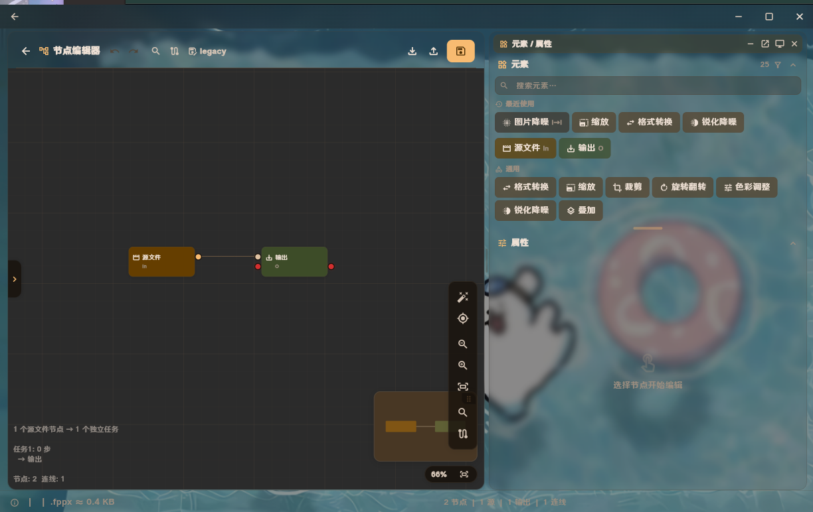

# FFmpeg++

<div align="center">

**Cross-platform audio, video, and image processing with visual node workflows**

[](https://flutter.dev)
[](https://flutter.dev)
[](https://isocpp.org)
[](https://ffmpeg.org)
[](LICENSE)

English | [简体中文](README.md)

> **Development approach:** Most code is developed with AI assistance; project direction, design decisions, and acceptance remain under human oversight.

</div>

---

## Overview

**FFmpeg++** is a cross-platform video, image, and audio processing application with a
**node editor**. Create and connect `Start → Process → Output` nodes on an infinite canvas;
the application validates the graph and generates the corresponding `ffmpeg` calls.

The interface uses **Flutter** and Material Design 3. A **C++17** shared library provides the
native backend through Dart FFI. **FFmpeg** performs media processing, while **ffprobe**
provides media information.

The experimental plugin system can package C/C++ node logic as constrained WebAssembly modules; the host validates and schedules their supported media operations. See the [plugin developer guide](docs/plugins/index.md).

### Use cases

- **Parameter configuration**: configure filters, encoders, stream mapping, and subtitle burn-in
  through nodes and parameter panels.
- **Batch processing**: reuse the same processing chain across multiple files.
- **Workflow inspection**: review processing relationships in the graph and inspect generated commands.

Node graphs can be inspected, saved, reused, and shared.

### Processing modes

| Mode | Intended use |
|------|----------|
| **Node Editor** | Define multi-step processing relationships for transcoding, filters, subtitles, and audio in one graph |
| **Quick Config** | Configure preset parameters for a single file and submit the task to the queue |

---

## Interface

### Main Window

The Projects page is the entry point: the sidebar switches between Projects / Queue /
Config Library / Settings. Media appears as cards with drag-and-drop import, thumbnail previews and
automatic ffprobe detection (codec, resolution, duration, bitrate). From a selected file you can open
the node editor or apply a quick-config preset. Processing tasks use the shared queue.
Use a file card’s **More → Apply saved configuration** menu to reuse a compatible node or quick-config
preset for video, audio, or images. Applying a configuration updates only that file’s pipeline; enqueue the file separately to execute it.

### Node Editor



The node editor is the main workflow workspace. The top toolbar provides save, undo, redo,
auto-layout, and debug-view controls. The central canvas connects nodes through ports; context
menus provide creation and deletion actions. The right panel displays the selected node’s parameters.
The application validates the graph before executing the generated FFmpeg calls.

---

## Node editor workflow

The basic workflow is **create nodes → connect nodes → execute the task**.

### Step 1 — Place nodes

Add processing nodes through the toolbar or context menu. Every pipeline starts with a **Start**
node and ends with an **Output** node; processing nodes go in between:

- **Transcode & filters**: video transcode (codec / bitrate / CRF / resolution / frame rate), video
  filters (brightness, contrast, saturation, gamma, hue, vignette, denoise, sharpen, grayscale),
  geometry (scale / flip / rotate), overlay (watermark / logo with 5-position placement, opacity,
  scale and margin).
- **Audio**: transcode, speed, volume, dynamic compression, fade in/out, metadata, audio extraction,
  reverse, and a three-band equalizer.
- **Image**: format conversion, crop, rotate, scale, brightness, adjust (saturation · gamma ·
  contrast), noise, sharpen, denoise, channel extraction.
- **Pacing & trimming**: speed change, time-range clipping, single-frame / range / full frame
  extraction, interactive video crop.
- **Combining**: concatenating multiple files, turning an image sequence into video, subtitle burn-in
  (SRT / ASS / SSA with a color picker and font selector).

The **Audio Spectrum / Audio Waveform** nodes generate a single PNG, JPG, or WebP image with
configurable dimensions. Their image outputs can continue through image processing nodes.
**Video Reverse** reverses the source audio alongside the picture; **Video Fade** can place
fade-out automatically from the current input duration. Reverse buffers media, so trim long files first.

Select a media category before filtering the node list, then sort by English name (A–Z) or usage.
Successful node additions update local usage counts. Reset them in Settings → Node usage;
favorites are preserved.

### Step 2 — Connect them into a graph

Connect an output port to the next node’s input port. The editor checks graph validity and
constructs the execution plan:

- cycle detection, connection type conflicts, dangling nodes, missing Start / Output nodes;
- duration constraints (for example when a clip duration is incompatible with a downstream node);
- compatible adjacent nodes can be combined into a **single ffmpeg command** to reduce repeated encoding.

**Logic blocks and logic gates** provide repetition and conditional execution. Loop blocks repeat
a sub-chain by count or condition. AND / OR / NOT / NAND / NOR / XOR / XNOR gates, constant 1 / 0,
and a time trigger participate in enable/status connections that control whether a processing node runs.

### Step 3 — Run and reuse

Each **source node** corresponds to an independent task, allowing one graph to be applied to
multiple files. The processing queue displays progress, processing speed, and estimated remaining time.

Save a validated graph to the **Config Library**, or export it as a `.fppx` configuration file for exchange.
Import checks compatibility with the application version and media type; successful execution must
still be verified with the intended media.

---

## Additional features

### AI Assistant

The built-in AI chat panel accepts natural-language requests, such as compressing a video and
adding a watermark. The configured model can generate or modify nodes and parameters on the canvas.

Both the **OpenAI** and **Anthropic** protocols are supported, with multiple model profiles and
multi-API-key rotation. Keys are encrypted locally.

### MCP Server (Model Context Protocol)

FFmpeg++ includes an MCP HTTP server (**off by default**) that exposes the following interfaces
to compatible AI clients and automation workflows:

- **Endpoint**: `http://127.0.0.1:<port>/`, JSON-RPC 2.0 over HTTP POST, with batch requests and
  protocol version negotiation;
- **Tools (27)**: canvas operations (`add_node` / `connect_nodes` / `modify_node_params` / `undo` /
  `save` / `rename_node` …), reads (`list_nodes` / `list_connections` / `get_graph_stats` /
  `error_check`), media and files (`probe_video` / `list_directory` / `read_file_info`), tasks
  (`list_tasks` / `get_task_info` / `cancel_tasks`), logic gates (`add_gate` / `set_gate_params`),
  containers (`list_containers` / `get_container_pipeline`) and more;
- **Resources (3)**: `pipeline://current`, `videos://loaded`, `tasks://all`;
- **Permission switches**: Allow Write (off by default — every mutating tool is rejected while off)
  and Allow File Access (on by default; gates directory listing, file info, media probing and log
  reading);
- **Security**: binds `127.0.0.1` only by default; switching to `0.0.0.0` exposes it on the LAN and
  then enforces an access token (`x-mcp-token` header or `Authorization: Bearer <token>`, shown in
  Settings).

> Clients that use stdio transport can connect through an HTTP ↔ stdio bridge such as `mcp-proxy`.

### Android

The same codebase also builds for Android (arm64-v8a, Android 8.0+) with touch adaptations:

- the sidebar becomes a bottom liquid-glass navigation bar with a draggable selection pill;
- Android 8.1+ supports Monet dynamic color, deriving a Material You palette from the wallpaper;
- **ffmpeg / ffprobe are bundled** as static arm64 executables inside the APK — no external
  dependency to install;
- H.264 / HEVC MediaCodec encoding options are available; actual support depends on the device, FFmpeg build, and parameters.

### Interface and runtime management

- **Interface**: dark / light themes, accent colors, background images, multiple surface styles
  (liquid glass / blur / solid), fonts and text scale, customizable keyboard shortcuts, Chinese and
  English UI;
- **FFmpeg install helper**: guided setup — winget on Windows, apt / dnf / pacman on Linux, Homebrew
  on macOS, plus importing from an existing archive;
- **Editing experience**: canvas auto-layout, undo / redo, autosave, and a debug overlay showing the
  execution plan;
- **Processing queue**: sequential batch execution, persisted results, per-task cancel and stop-all;
- **App updates**: built-in update check, download and install (SHA-256 verified).
- **Detailed diagnostics**: enable **Settings → Advanced → Debug → Very verbose logs** (off by default). The preference takes effect immediately and persists. Use the **Trace** filter in Logs for operation IDs, elapsed times, counts and failure types across startup, storage, media probing, tasks, pipeline steps, processes, previews, AI and MCP; ordinary Debug Mode is independent. To save these entries, also enable **Save Logs** and choose a directory (10 MiB per file, one rotated backup; the UI retains the latest 2000 entries). New trace events contain fixed labels and statistics, without request bodies, commands, file paths or credentials. MCP log reads exclude trace entries.

---

## Download and installation

The repository defines release packages for the following platforms:

| Platform | Architecture | Package |
|----------|--------------|---------|
| **Windows** | x64 | `FFmpeg++_v*_setup.exe` |
| **Linux** | x64 | `ffmpegpp_*_amd64.deb` |
| **Linux** | ARM64 | `ffmpegpp_*_arm64.deb` |
| **macOS** | Universal (Intel + Apple Silicon) | `FFmpeg++_v*_macOS.dmg` |
| **Android** | arm64-v8a | `app-release.apk` |

### Release packages

**[GitHub Releases (available installers)](https://github.com/lvbaoshigao/FFmpeg_plus_plus/releases)**

Pick the matching file from the **Assets** section of the release. The Windows installer ships with
Simplified Chinese, Traditional Chinese and English setup wizards; the `.deb` packages install with
`sudo dpkg -i` or `sudo apt install ./*.deb`.

> **FFmpeg dependency:** If `ffmpeg` / `ffprobe` are not detected at first launch on desktop,
> the application provides installation guidance (winget / apt / dnf / pacman / Homebrew) or archive import.
> The Android package includes these executables.

---

## Star history

<a href="https://star-history.com/#lvbaoshigao/FFmpeg_plus_plus&Date">
  <picture>
    <source media="(prefers-color-scheme: dark)" srcset="https://api.star-history.com/svg?repos=lvbaoshigao/FFmpeg_plus_plus&type=Date&theme=dark" />
    <source media="(prefers-color-scheme: light)" srcset="https://api.star-history.com/svg?repos=lvbaoshigao/FFmpeg_plus_plus&type=Date" />
    
  </picture>
</a>

---

## Building from source

<details>
<summary>Requirements, build procedure, and technology stack</summary>

### Architecture

```
┌──────────────────────────────────┐
│   Flutter GUI (Dart)             │  ← Material Design 3
│   Dart FFI ↔ libffmpegpp         │
├──────────────────────────────────┤
│   C++17 backend (dll / so / dylib)│  ← shared library, message-queue polling
│   subprocess → ffmpeg / ffprobe  │
├──────────────────────────────────┤
│   FFmpeg / FFprobe               │  ← external process
└──────────────────────────────────┘
```

### Prerequisites

- [Flutter SDK](https://flutter.dev) 3.44+
- [CMake](https://cmake.org) 3.20+
- **Windows**: Visual Studio 2022/2025 with the C++ desktop workload, and
  [Inno Setup](https://jrsoftware.org/isinfo.php) 6+
- **Linux**: `cmake g++ libgtk-3-dev pkg-config ninja-build`
- **macOS**: Xcode Command Line Tools
- **Android**: Android SDK + NDK 28.2 + JDK 17+

### Manual build

```bash
# 1. Build the C++ backend
cd server_cpp
mkdir -p build && cd build
cmake .. -DCMAKE_BUILD_TYPE=Release
make -j$(nproc)                 # Linux / macOS
# Windows: cmake .. -G "NMake Makefiles" && nmake

# 2. Run the Flutter GUI
cd ../../ffmpegpp_gui
flutter pub get
flutter run -d linux            # or -d windows / -d macos
```

### Build scripts

Build scripts are maintained in `build/`; see [`build/README.md`](build/README.md):

```bash
build/build_all.sh all          # desktop + Android APK
build/build_all.sh desktop      # desktop only
build/build_all.sh android      # Android APK only
```

Build outputs:

| Platform | Path |
|----------|------|
| Windows | `ffmpegpp_gui/build/windows/x64/runner/Release/` |
| Linux | `ffmpegpp_gui/build/linux/x64/release/bundle/` |
| Android | `ffmpegpp_gui/build/app/outputs/flutter-apk/app-release.apk` |

### Repository layout

```
FFmpeg_plus_plus/
├── ffmpegpp_gui/     # Flutter frontend (UI, state, node editor, MCP server)
├── server_cpp/       # C++17 backend (command generation, process control, .fppx codec, probing)
├── build/            # Unified build scripts (desktop / Android)
├── make/             # Installer script and icon assets
└── .github/          # GitHub Actions release pipeline
```

### Technology stack

| Layer | Technology |
|-------|------------|
| UI framework | Flutter 3.44 · Material Design 3 |
| State management | Provider (ChangeNotifier) |
| Backend | C++17 shared library (dll / so / dylib), loaded via Dart FFI |
| Processing engine | FFmpeg 8.0 / ffprobe (subprocess) |
| Audio preview | just_audio (GStreamer on Linux) |
| Installers | Inno Setup (Windows) · dpkg-deb (Linux) · hdiutil (macOS) |
| CI/CD | GitHub Actions — Windows / Linux x64 / Linux ARM64 / macOS / Android |

</details>

---

<div align="center">

<sub>Flutter · C++17 · FFmpeg · Code developed with AI assistance and human design and review</sub>

MIT License — see [LICENSE](LICENSE)

</div>
